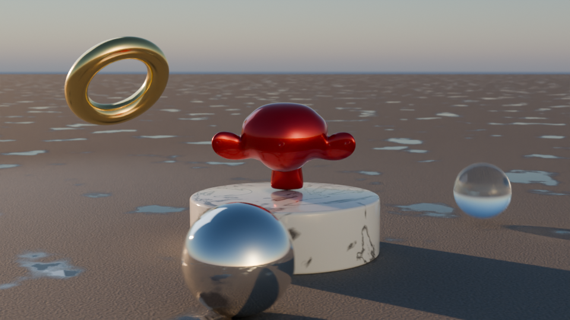

# Realistic Blender Animation — "Golden Hour Showcase"

`realistic_animation.py` builds a fully procedural, photoreal 10-second scene and renders it with Cycles.



## What's in it
- **Materials (PBR, all procedural):** mirror chrome, brushed gold, clear glass, veined marble with subsurface, red metallic-flake car paint with clear coat, and wet concrete with glossy puddles
- **Lighting:** a physical sky and a warm low sun for golden hour, plus a cool area fill light
- **Animation:** a chrome ball that rolls with matching spin, a glass sphere that bounces with squash and stretch, a floating gold torus, and Suzanne on a marble turntable
- **Camera:** eased orbit and push-in, f/2 depth of field, 180° shutter motion blur
- **Output:** AgX color management (Filmic on older versions), denoising, 1920×1080 at 24 fps, H.264 MP4

## Run it
**In Blender:** open the *Scripting* tab, open the file, then click **Run Script**. Press F12 to render a still or Ctrl+F12 to render the animation.

**From the command line:**
```bash
blender -b -P realistic_animation.py -- --render            # full quality → render/golden_hour_*.mp4
blender -b -P realistic_animation.py -- --render --preview  # fast half-res draft
blender -b -P realistic_animation.py -- --save scene.blend  # build and save only
```

The script uses a GPU automatically if one is available (OptiX, CUDA, HIP, Metal or oneAPI). To change the length, resolution, sample count or sun angle, edit the constants at the top of the file.

Tested with Blender 5.0. Version differences in the Blender 3.6 and 4.x APIs are handled.
